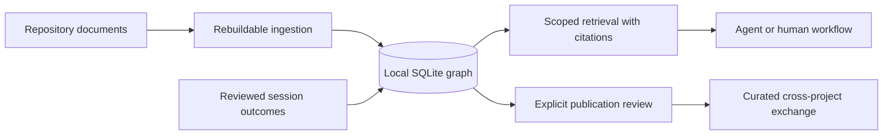

# mem-graph

An exploratory project for an engineering-memory capability that helps agents
and people reuse decisions, failed approaches, resolutions, and verified
lessons across software projects. The repository currently contains the
roadmap and design direction only; no runnable application has been published.

## Table of Contents

- [About](#about)
- [Features](#features)
- [Tech Stack](#tech-stack)
- [Architecture](#architecture)
- [Project Structure](#project-structure)
- [Getting Started](#getting-started)
- [Configuration](#configuration)
- [Security](#security)
- [How to Contribute](#how-to-contribute)
- [What's Next](#whats-next)
- [License](#license)
- [Acknowledgements](#acknowledgements)
- [Author](#author)

## About

The proposed system would preserve the reasoning behind engineering work:
which constraints mattered, which approaches failed, what resolved the issue,
and where a lesson applies. Repository documentation would remain authoritative,
while a local SQLite knowledge graph would be a rebuildable derived index.
Cross-project sharing is intentionally scoped as a later, explicitly curated
publication layer rather than automatic replication.

The current implementation status is **pre-implementation**. See
[PLAN.md](PLAN.md) for phases, acceptance gates, risks, and deferred decisions.

## Features

| Capability | Status |
|---|---|
| Evidence-backed engineering-memory model | Planned |
| Rebuildable local SQLite graph | Planned |
| Document ingestion with provenance and citations | Planned |
| Scoped retrieval with applicability and conflicting evidence | Planned |
| Session outcome capture and lesson review | Planned |
| CLI and MCP integration | Planned |
| Curated cross-project publication | Planned |

None of these capabilities is available as a runnable implementation in this
repository yet.

## Tech Stack

No implementation language, package manager, framework, database schema, or
runtime has been selected. The roadmap proposes evaluating SQLite for local
storage and full-text retrieval, but this is not an implemented dependency.

The repository currently uses Markdown for its README and roadmap, Git for
version control, and the MIT license.

## Architecture

The target architecture is intentionally a future design, not a description of
running components:



Repository documents remain the source of truth. The graph is intended to be
derived and rebuildable, while authored lesson approvals and session records
must remain separately recoverable. The architectural direction is recorded in
[ADR-0001](docs/adr/0001-repository-documents-as-source-of-truth.md).

## Project Structure

- `README.md` — project overview and documentation entry point.
- `PLAN.md` — proposed implementation roadmap, acceptance gates, risks, and
  deferred decisions.
- `docs/user-guide.md` — current and planned user workflows, with the current
  pre-implementation boundary stated explicitly.
- `docs/admin-guide.md` — developer/operator guidance for the current
  documentation-only repository and future operational requirements.
- `docs/adr/` — architectural decision records.
- `docs/releases/` — release communication for the current unreleased state.
- `CHANGELOG.md` — Keep a Changelog-compatible change history.
- `LICENSE` — MIT license.

Repository tooling and agent-skill files are not product components.

## Getting Started

### Prerequisites

- Git.
- A Markdown editor or viewer.
- No language runtime, package manager, database, or service is currently
  required because no executable component exists.

### Inspect the project

```bash
git clone https://github.com/McFuzzySquirrel/mem-graph.git
cd mem-graph
sed -n '1,220p' README.md
sed -n '1,220p' PLAN.md
```

These commands are the current repository workflow. There is no install or run
command until implementation begins.

## Configuration

There is no application configuration, environment variable, command-line
interface, endpoint, database path, or deployment configuration yet. Future
configuration must be documented with safe placeholders and tied to the
implemented source; the roadmap specifically calls for explicit project roots,
included and excluded paths, scopes, and access boundaries.

See the [administrator guide](docs/admin-guide.md) for the current operator
workflow and future configuration requirements.

## Security

No authentication, authorization, network service, or secret-handling mechanism
is implemented. The roadmap treats retrieved content as untrusted evidence,
requires scope filtering before search and traversal, and calls for explicit
review and redaction before cross-project publication.

Do not put credentials, private repository content, or sensitive lesson data in
this repository. For a suspected vulnerability in future implementation,
create a private report through the repository maintainer rather than
publishing sensitive details in an issue.

## How to Contribute

There is no `CONTRIBUTING.md` yet. For now:

1. Read [PLAN.md](PLAN.md), especially the product principles and phase gates.
2. Keep proposed behavior separate from implemented behavior.
3. Record durable architectural choices in a focused ADR.
4. Validate documentation changes with `git diff --check` and local link checks.
5. Submit a focused pull request describing evidence, limitations, and
   validation performed.

Implementation work should establish language, packaging, build, lint, and test
commands as part of phase 2.

## What's Next

The next work is **planned, not shipped**: validate representative use cases
and source formats, define the memory and trust contracts, then choose the
implementation ecosystem. The full dependency-ordered roadmap and go/no-go
gates are in [PLAN.md](PLAN.md).

In particular, the project must not begin cross-project publication before the
local pilot demonstrates usefulness, privacy, and access-control correctness.

## License

This project is licensed under the [MIT License](LICENSE).

## Acknowledgements

No third-party runtime or integration is currently implemented. The roadmap
acknowledges the project's existing documentation and agent-workflow inputs as
discovery material, but those inputs are not verified integration contracts.

## Author

Maintained by [McFuzzySquirrel](https://github.com/McFuzzySquirrel). Use the
repository's GitHub issues for public questions, proposed changes, and
collaboration.

For detailed workflows, see the [user guide](docs/user-guide.md), [administrator
guide](docs/admin-guide.md), [ADR index](docs/adr/README.md), [changelog](CHANGELOG.md),
and [unreleased notes](docs/releases/unreleased.md).
